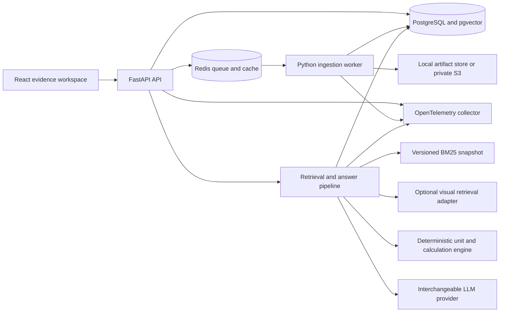
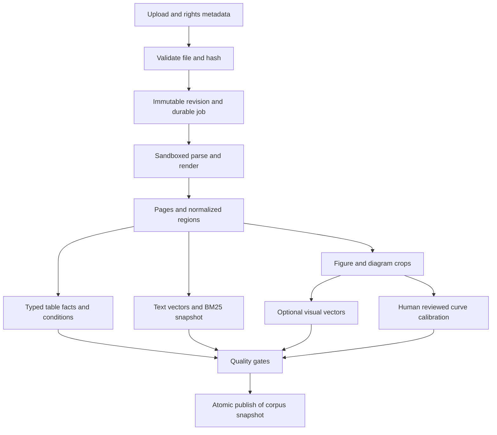
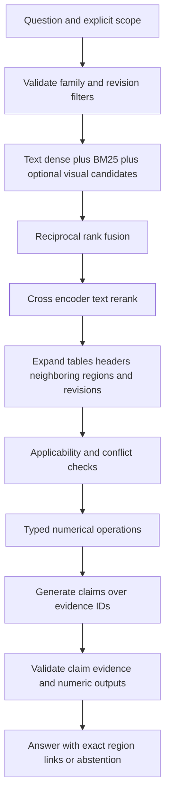

# Architecture and technology decisions

Status: proposed; no services are running. Read [requirements](PROJECT_SPEC.md),
[database contract](docs/SCHEMA.md) and [API contract](docs/API.md) together.

## Alternatives
1. **Recommended: Python modular application + independent worker + PostgreSQL.**
   Keeps provenance and vectors together; easiest to learn, test and operate solo.
2. Managed vector database + hosted document pipeline: quicker infrastructure but
   less control over region identity, costs and extraction experiments.
3. Microservices + dedicated multimodal search cluster: more independent scaling,
   but too much operational overhead for this corpus and six-week learning schedule.

These are planning recommendations, not owner-approved implementation choices.

## System view


## Ingestion flow

Do not hold a database transaction during model calls. Write artifacts to temporary
keys; checksum and atomically publish a completed manifest. Job states are queued,
running, needs_review, succeeded, failed and cancelled. PostgreSQL is the job source
of truth; Redis delivery can repeat. A reconciler re-enqueues committed pending jobs
if enqueue fails. Use leased work, heartbeats, bounded attempts, backoff and a dead
letter state. Ingest dedup key: file hash + extraction config/version. Snapshot
publication excludes failed or incomplete modalities and labels that limitation.

## Query flow

Start with 30 candidates per channel, RRF constant 60 and top 10 after reranking;
these are tuning defaults, not optimality claims. Bound evidence to a token budget
and preserve table headers. Tune on development data only. Text rerankers do not
magically score image content: rerank visual candidates using reviewed/OCR text or
captions, retain channel scores, and measure visual candidate loss. A later visual
reranker must be its own experiment. Follow related errata edges with a bounded
one-hop expansion; do not rely solely on their similarity to the query.

## Justified stack and adoption gates
| Layer | Proposed choice | Alternatives / reason / gate |
|---|---|---|
| API/domain | Python 3.12, FastAPI, Pydantic | Typed contracts; compatibility spike before locking |
| Persistence | PostgreSQL + pgvector, SQLAlchemy/Alembic | One transactional provenance store; avoid separate vector service initially |
| Keyword | BM25 via small local library and immutable snapshot | Postgres FTS is useful but is not BM25; Elasticsearch is unnecessary here |
| Extraction | Docling adapter, render backend isolated | Benchmark 20 pages before selection; retain native bounding boxes and transforms |
| PDF rendering | Evaluate pypdfium2 vs PyMuPDF | Check exact licenses, coordinate fidelity and parser compatibility before choosing |
| Text embeddings | Small Hugging Face sentence embedding model | Choose pinned checkpoint with acceptable license, CPU memory and recall |
| Reranking | Small cross-encoder through sentence-transformers | Compare latency/recall; pin checkpoint and tokenizer |
| Visual retrieval | SigLIP pooled vectors first experiment; ColPali comparator | SigLIP simpler pgvector representation; ColPali late interaction needs multivector storage/scoring |
| ML execution | PyTorch behind optional adapter | Only install when selected models require it; no GPU assumption |
| Curves | OpenCV + reviewed calibration | No generic vision-agent numeric extraction as ground truth |
| Units | Pint + Decimal where appropriate | Define supported unit spellings; disallow arbitrary expressions and offset misuse |
| Jobs/cache | Redis + RQ, durable DB job record | FastAPI background tasks are not a durable queue; Celery unnecessary initially |
| LLM | Own small provider protocol + provider SDK adapters | LangChain optional if it removes demonstrated boilerplate; no orchestration dependency by default |
| UI | React + TypeScript + Vite, PDF.js | Familiar tooling and region overlays; no SSR requirement |
| Observability | OpenTelemetry, structured logs | Hosted tracing optional, content capture off by default |
| Delivery | Docker Compose, GitHub Actions | AWS only after local correctness; no Kubernetes |

PyMuPDF's licensing needs a deliberate compatibility decision; do not install it
merely because it is preferred. ColPali has model/base-model terms distinct from
code licensing. Redis distribution/version terms also require review before pinning;
Valkey is an alternative if distribution constraints warrant it. No versions or
model weights are locked in this planning commit. Phase 1 must write a compatibility
matrix and reproducible lockfiles before adopting dependencies.

ColPali cannot be represented faithfully by one pooled page vector. Store its
per-patch vectors in versioned artifacts, first-stage shortlist pages, then compute
late-interaction scores over that bounded set; a dedicated multivector index is a
later scale decision. Measure memory and compare to single-vector SigLIP rather
than assuming either handles technical text accurately.

## Module boundaries
Proposed future layout (directories below do not yet exist):
```text
backend/
  pyproject.toml
  src/errata/
    api/           # HTTP contracts, authentication, no extraction logic
    domain/        # evidence, facts, revisions, units, supported operations
    ingestion/     # jobs, parser adapters, region normalization
    retrieval/     # dense, BM25, fusion, reranking, visual adapters
    reasoning/     # applicability, calculations, claim validation
    providers/     # LLM/embedding interfaces, usage accounting
    storage/       # repositories, artifacts, snapshot publication
    telemetry/     # trace spans, metrics and content redaction
  migrations/
  tests/           # unit, integration, adversarial, end-to-end
frontend/src/      # evidence workspace and API client
benchmarks/        # versioned manifests, annotations, runner, reports
infra/            # Compose first, AWS configuration later
scripts/          # repository tools and future reproducible entrypoints
docs/             # contracts, ADRs, learning walkthroughs and runbooks
```
Adapters: `DocumentParser.parse`, `Embedder.embed_text/embed_image`,
`Retriever.search`, `Reranker.rank`, `LLMProvider.generate`, `ArtifactStore.get/put`.
Every adapter returns typed records including version and usage metadata. Generation
must return structured claims with existing evidence IDs; reject unknown IDs.
Provider failures/timeouts yield explicit degraded/abstained states, not invented text.

## Caching and observability
Cache key includes tenant/scope (even single-user), normalized query, filters,
corpus snapshot, extraction/embedding/rerank versions, prompt hash, provider model,
unit engine version and answer policy. Use bounded TTL; deletion purges relevant
entries. Never share cache answers across access scopes. Store error states separately.
Trace spans: upload, parse, embed, keyword, dense, visual, fusion, rerank, resolve,
calculate, generate, validate. Record p50/p95, queue age, failure count, cache hit,
tokens, GPU seconds and estimated dollars with pricing-table date; avoid raw content.

## Evidence UI sketch
```text
[Corpus snapshot] [Family / revision]       [Ingestion status]
[Question........................................] [Ask]
Answer / status                 | Page image: highlighted evidence
- Claim with citation [1]       | Document title · revision · page
- Conditions and units         | Region type · extraction review status
- Calculation and uncertainty  | Table headers / original text
- Conflicts / missing evidence | Previous / next evidence
```
The owner should be able to trace any displayed number back through the code to
its original cell or approved curve sample.

## Primary references checked November 24, 2026
- [pgvector documentation](https://github.com/pgvector/pgvector): vector search and hybrid patterns.
- [Docling documentation](https://docling-project.github.io/docling/usage/supported_formats/): supported format surface; project must independently test quality.
- [PyMuPDF licensing](https://pymupdf.readthedocs.io/en/latest/about.html): follow License and Copyright before dependency adoption.
- [ColPali model license](https://huggingface.co/vidore/colpali/blob/main/LICENSE): inspect selected checkpoint and base-model terms.
