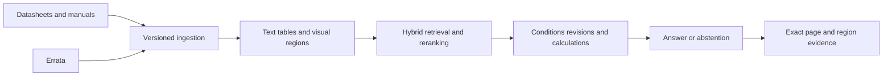

<div align="center">

# Errata

### Technical answers. Traceable evidence.

A planned multimodal technical intelligence engine for datasheets, manuals and errata.

**Planning & repository setup · No application implemented · No benchmark results**

[Product specification](PROJECT_SPEC.md) · [Architecture](ARCHITECTURE.md) · [Roadmap](ROADMAP.md) · [Evaluation](EVALUATION.md)

</div>

---

## Why Errata?

A specification may live in a table, depend on a temperature curve, or be qualified
by an erratum published later. Retrieving a paragraph is often only the first step.

Errata is designed to connect **document revisions, page regions, structured facts
and deterministic calculations** so every answer can be inspected. When the evidence
is missing or contradictory, the intended behavior is to say so.

> Illustrative workflow: “At this supply voltage and temperature, what value applies,
> and does the erratum change it?” Errata should show the relevant table or curve,
> the applicable revision, any calculation and the supporting image regions.
>
> This describes planned behavior, not an available demonstration.

## What will make it useful

| Evidence | Planned behavior |
|---|---|
| Text | Find exact technical terms and semantically related passages |
| Tables | Keep numbers connected to headers, units, conditions and footnotes |
| Graphs | Digitize a bounded class of reviewed curves and report uncertainty |
| Figures and diagrams | Retrieve and cite exact regions; richer interpretation comes later |
| Related documents | Follow explicit applicability and revision relationships |
| Missing or conflicting evidence | Abstain or show ambiguity with reasons |



## Project status

This repository currently contains the full planning package, a local documentation
environment, an example configuration and documentation CI. It does **not** contain
an API, frontend, database implementation, downloaded corpus, reviewed evaluation
questions or trained models. The complete plan is ready for owner review before coding.

The six-week plan targets a local-first MVP for one developer working about 15–20
hours/week. A text/table end-to-end slice comes first. Assisted graph digitization,
revision reasoning and visual retrieval are staged behind measurable gates; the
full research release may extend beyond six weeks.

## Read the plan

| Document | Contents |
|---|---|
| [PROJECT_SPEC.md](PROJECT_SPEC.md) | PRD, SRS, requirement IDs, MVP/stretch scope and acceptance expectations |
| [ARCHITECTURE.md](ARCHITECTURE.md) | System/data-flow diagrams, alternatives, stack decisions and planned modules |
| [ROADMAP.md](ROADMAP.md) | Six weeks of milestones, learning time, scope gates and phase acceptance |
| [EVALUATION.md](EVALUATION.md) | 100-question review plan, three benchmark arms, metrics, judge and CI strategy |
| [Database schema](docs/SCHEMA.md) | Entities, relationships, spatial conventions, indexes and migrations |
| [API specification](docs/API.md) | Proposed endpoints, request/response contracts and error semantics |
| [Deployment and costs](docs/DEPLOYMENT.md) | Local-to-AWS strategy, budget assumptions and complete setup checklist |
| [Threat model](docs/SECURITY.md) | Trust boundaries, risks, controls and verification |
| [Learning plan](docs/LEARNING.md) | Code walkthrough agreement, exercises and vector-database learning sequence |
| [AGENTS.md](AGENTS.md) | Environment commands, contribution rules and verification requirements |

## Proposed technology

**Backend:** Python, FastAPI, Pydantic, PostgreSQL + pgvector, BM25 and Redis workers.
**Evidence processing:** Docling, a license-reviewed PDF renderer, OpenCV and typed units.
**Models:** Hugging Face/PyTorch text embeddings and cross-encoder; SigLIP/ColPali
experiments behind interchangeable adapters.
**Interface and operations:** React, TypeScript, Docker, Pytest, GitHub Actions and
OpenTelemetry; AWS after local validation.

These are reasoned proposals, not a dependency shopping list. LangChain is optional;
no orchestrator is needed unless it demonstrably simplifies the code. Model versions,
licenses, memory requirements and extraction quality must be checked before adoption.
See the [decision matrix](ARCHITECTURE.md).

## Evaluation, without invented scores

The planned dataset has at least **100 manually reviewed questions** across text,
tables, numerical graphs, cross-document questions, conflicting versions and
unanswerable cases. Current reviewed count: **0**.

Compare a strong text-only baseline, a caption-based multimodal baseline and the
complete Errata pipeline on the same frozen sources. Report retrieval quality,
numerical/unit accuracy, citation support, faithfulness, abstention, latency and
cost—with raw runs and limitations. A partial pipeline will be labeled as partial.

## Start with the documentation

```bash
git clone https://github.com/rishibhansali/errata.git
cd errata
python3 -m venv .venv
.venv/bin/python scripts/check_docs.py
```

The checker uses Python's standard library and needs no installed packages. The
setup environment was verified with Python 3.14.0; the application runtime will be
selected during the dependency compatibility phase. This command checks required
planning files, local file links and closed code fences; it does not test an app,
validate external URLs or render Mermaid diagrams.

No cloud account, provider key or paid service is needed to read or validate the plan.
`.env.example` documents proposed settings; no application consumes them yet.

## Learn while building

This is Rishi Bhansali's personal engineering and learning project. Implementation
sessions will explain the concept, walk through the code, demonstrate tests and
leave a small hands-on exercise. Vector databases, retrieval tradeoffs, numerical
reasoning and deployment will each be taught through the project's own code.

The [learning plan](docs/LEARNING.md) makes that agreement explicit. The next step
is to review the scope and roadmap together, then start the first small coding slice.

## Source rights and project license

Project-authored code and documentation are [MIT licensed](LICENSE). That license
does not apply to third-party datasheets, manuals, model weights or dependencies.
Public accessibility does not establish redistribution rights. The initial corpus
will use a source/rights manifest; vendor PDFs and derived crops stay outside Git
unless redistribution is explicitly permitted.

**Owner and maintainer:** [Rishi Bhansali](https://github.com/rishibhansali).
