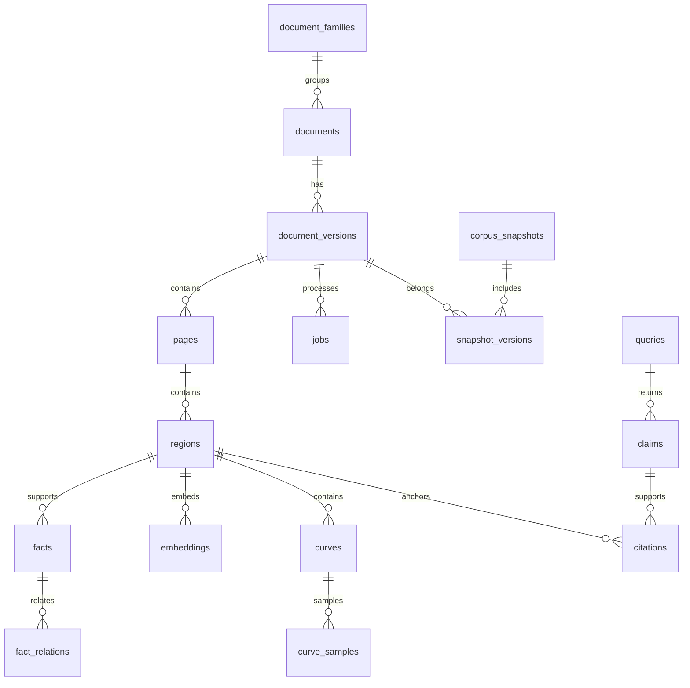

# Database schema specification

Proposed PostgreSQL schema, not executed migrations. IDs are UUIDs; timestamps are
UTC `timestamptz`. Foreign keys are explicit. Artifacts remain outside PostgreSQL.

| Table | Fields / constraints |
|---|---|
| document_families | id PK, manufacturer, family_name; unique(manufacturer, family_name) |
| documents | id PK, family_id FK, publisher_document_id, title, kind enum(datasheet/manual/erratum), source_url |
| document_versions | id PK, document_id FK, revision_label, published_at nullable, retrieved_at, sha256, artifact_key, terms_url, rights_status, review_by, metadata JSONB; unique(document_id, sha256) |
| revision_relations | id PK, from_version FK, to_version FK, type(supersedes/qualifies/references), applicability JSONB, evidence_region_id FK nullable, reviewed_by; no self-edge |
| pages | id PK, version_id FK, page_index zero-based, printed_label nullable, width_pt, height_pt, rotation, render_key, render_sha256; unique(version_id, page_index) |
| extraction_runs | id PK, version_id FK, parser_version, config_hash, started_at, completed_at, status; unique(version_id, parser_version, config_hash) |
| regions | id PK, page_id FK, extraction_run_id FK, parent_id self FK nullable, kind, bbox JSONB, coordinate_transform JSONB, text, artifact_key, reading_order, review_status |
| table_cells | id PK, region_id FK, row_index, col_index, row_span, col_span, text, bbox, header_cell_ids UUID[], footnote_region_ids UUID[]; unique(region_id,row_index,col_index) |
| facts | id PK, region_id FK, cell_id FK nullable, parameter, raw_value, value_decimal NUMERIC nullable, lower_value/upper_value NUMERIC nullable, raw_unit, canonical_unit, dimension, role(min/typ/max/exact), comparator, conditions JSONB, applicability JSONB, extraction_status |
| fact_relations | id PK, from_fact FK, to_fact FK, relation_type, reason, evidence_region_id FK, review_status, reviewed_by |
| embeddings | id PK, region_id FK, model_id FK, modality, vector; unique(region_id,model_id,modality) |
| model_registry | id PK, name, immutable_revision, dimension, normalization, distance_metric, license_ref |
| visual_artifacts | region_id FK, model_id FK, patch_vectors_key, checksum, patch_count; composite PK(region_id,model_id) |
| curves | id PK, region_id FK, graph_type, x_unit, y_unit, x_scale/y_scale, anchors JSONB, calibration JSONB, pixel_error, approved_by nullable, reviewed_at, supported_domain JSONB |
| curve_samples | curve_id FK, sample_index, pixel_x/pixel_y, x/y DOUBLE PRECISION, error_bound; PK(curve_id,sample_index) |
| corpus_snapshots | id PK, manifest_sha256 UNIQUE, bm25_artifact_key, model_config JSONB, published_at nullable, status |
| snapshot_versions | snapshot_id FK, version_id FK, extraction_run_id FK; PK(snapshot_id,version_id) |
| jobs | id PK, version_id FK, idempotency_key UNIQUE, status, stage, attempts, lease_until, heartbeat_at, safe_error, created_at, updated_at |
| queries | id PK, snapshot_id FK, scope_hash, question nullable/redacted by default, config_hash, status, latency_ms, estimated_cost, usage JSONB, trace_id |
| claims | id PK, query_id FK, text, kind, numeric_result JSONB nullable, evidence_status |
| citations | id PK, claim_id FK, region_id FK, fact_id FK nullable, curve_id FK nullable, evidence_role, calculation_id FK nullable |
| calculations | id PK, query_id FK, operation, input_fact_ids UUID[], input_curve_ids UUID[], canonical_inputs JSONB, output JSONB, engine_version |

## Spatial and numerical invariants
`bbox = [x0,y0,x1,y1]`, normalized to [0,1], top-left origin on the displayed,
rotation-corrected page; x0<x1 and y0<y1. Preserve original parser coordinates and
explicit transform, crop box, rotation and rendered dimensions. Page numbers in
citations are one-based PDF indices; printed labels are shown separately. Tests
cover rotated and cropped PDFs and rounding near boundaries. Table-cell evidence
includes header/footnote context rather than only a cropped numeric glyph.

Facts retain source precision, qualifiers (`<`, `≤`, range) and units. Missing unit
is unknown, never dimensionless by assumption. Canonicalization must not erase
conditions. Store graph estimates as approximate with calibration error; decimal
storage alone does not make extraction exact. Offset temperature conversions and
temperature differences are distinct operations.

## Index and migration plan
B-tree indexes on version/page, family/document, job status/lease, snapshot membership
and relation endpoints. JSONB indexes only after measured query need. Start with
exact vector scan for the small corpus; benchmark HNSW before adopting it. A single
vector column/index cannot mix incompatible dimensions. Use one embedding table or
partition per model dimension with model-specific query paths and indexes; migration
creates a new versioned embedding store and backfills before atomic snapshot switch.
Keyword indexes are immutable BM25 artifacts keyed to snapshot membership and text
normalization version; apply identical filters to every retrieval channel.

Use Alembic migrations with upgrade tests against real PostgreSQL+pgvector, backup
before destructive migrations and documented downgrade/restore behavior. Never
update old citation targets in place. Delete requests tombstone evidence, invalidate
caches and delete artifacts according to retention policy; historical answers then
show evidence unavailable rather than linking to a different revision.
